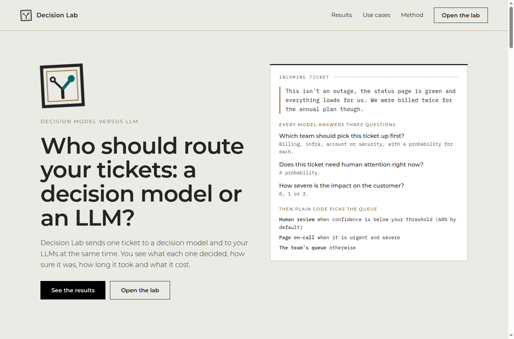
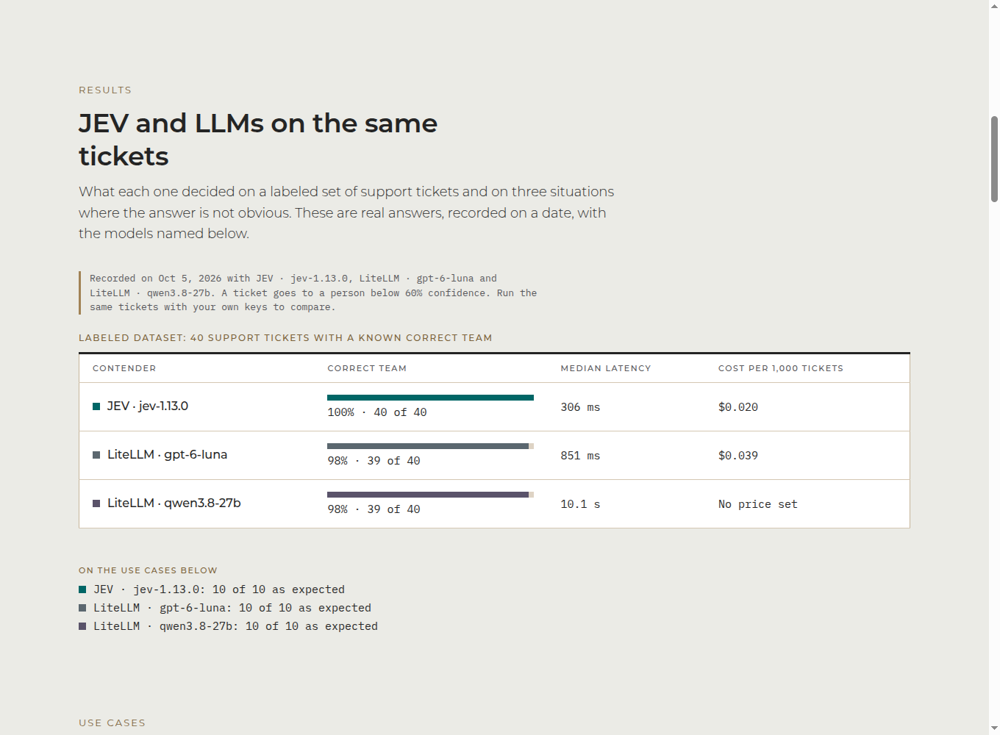
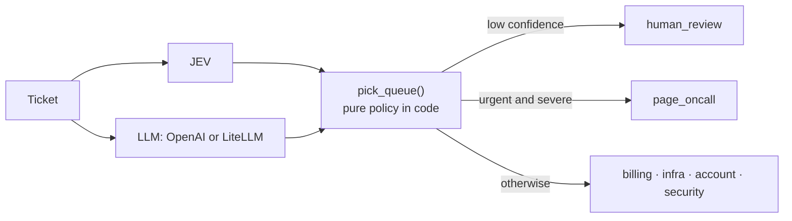

<div align="center">


# Decision Lab

**Race a decision model against LLMs on the same ticket, live, and measure who is right, how sure it is, how fast and how much it costs.**






</div>

Research companion for exploring **decision models** ("System One": JEV, Kev, Laya…) versus **generative LLMs**. Same task (support-ticket triage), same routing policy, interchangeable backends, so the comparison is made with measurements instead of intuition.

## What's inside

| Package | What it is |
|---|---|
| [`jev-vs-llm/`](jev-vs-llm) | **Decision Lab**: a web app that tests a decision model (JEV) against an LLM (OpenAI or your own LiteLLM) on your tickets, scored against the answers you give. Web only: credentials are typed in the page. |
| [`decision-patterns/`](decision-patterns) | Where to put a decision model inside an agent: **router**, **tool gate** and **verified cascade**, as small LangGraph graphs, tested offline (a library, no CLI). |

## Features

- **A clear setup.** JEV (TypeSafe key) against **one or more LLMs**: from OpenAI, or from your own LiteLLM proxy (choose which). Paste the key and add up to four models to compare side by side. Models load from your own account and prices from [LiteLLM's public price list](https://github.com/BerriAI/litellm/blob/main/model_prices_and_context_window.json) (which cites each vendor's pricing page, JEV's included); a price you type always wins. The server has no model menu, price file or endpoint list to maintain.
- **Your tickets, your ground truth.** Type one ticket, paste a batch (JSON lines or CSV), or start from a use case or the labeled dataset, then edit. Each ticket carries the answer you expect: the correct team (required) and, optionally, whether it should page on-call.
- **Results you can read.** Accuracy against your answers, paging accuracy, median latency and cost per contender, then a ticket-by-ticket table with each contender's queue, confidence, probabilities and a plain "Correct / Wrong team" verdict. Closing the page cancels the run, so you stop paying for tokens.
- **A landing page that presents the results.** `/` shows what the lab does, the recorded numbers for JEV and the LLM on the labeled dataset, and three use cases ticket by ticket (wording that points the other way, who gets paged at 2 a.m., a ticket that gives orders) with a rubber stamp for each answer.
- **Bring your own keys.** There is no other way to give the app a key: no command line, no environment variables. The server holds no provider keys, stores nothing and redacts keys from errors, so you can share a deployment without anyone spending your tokens.
- **Works without keys.** Tick the free keyword baseline to try the interface before connecting anything.



> The rule behind the repo: **code calculates and authorizes, the decision model judges, an LLM generates and reasons, anything uncertain or irreversible goes to a human.**

## Requirements

- [uv](https://docs.astral.sh/uv/getting-started/installation/) (it installs the right Python for you)
- Optional: your own TypeSafe key (for JEV) and/or OpenAI key, typed into the page. Without them the demo matcher still works

## Install

```bash
git clone https://github.com/Kr4is/jev-decision-lab.git
cd jev-decision-lab
uv sync                      # creates .venv and installs both packages plus dev tools
```

## Run

### The web app

```bash
uv run jevllm-web                    # http://127.0.0.1:8765
```

There is nothing to configure. Open `/lab` and follow the three steps:

1. **Connect your contenders.** Paste your TypeSafe key for JEV. For the LLM choose **OpenAI** (paste its key) or **LiteLLM** (its address, for example `http://litellm:4000`, and its key), then add the models to compare: type each id and press *Add*, or press *Load the models from my account* to pick from your list. You can add several (up to four). Prices appear on their own; type yours if a model has none.
2. **Choose the tickets.** Start from a use case or the labeled dataset, add a ticket, or paste a batch. Give every ticket its correct team (and, if you like, whether it should page on-call).
3. **Run it.** Read the scoreboard and the ticket-by-ticket table.

Keys, the LiteLLM address and your settings live in your browser tab (or on the device if you tick *Remember*) and are sent only with your own requests.

**About addresses.** The server calls the LiteLLM address you type, so it checks it: `http`/`https` only, no credentials in the URL, no redirects, and never link-local addresses such as the cloud metadata service. Loopback and LAN addresses are allowed by default because a homelab proxy lives there. On an instance other people can reach, set `BLOCK_PRIVATE_URLS=1` to refuse those too. The server binds to `127.0.0.1` by default; to share it, pass `--host 0.0.0.0` and put it behind HTTPS, because keys travel in request bodies (the page warns when it is served over plain HTTP from a non-local address). There is no login, but nobody's keys live on the server, so an open instance can only spend the tokens of whoever uses it.

| Optional setting | Purpose |
|---|---|
| `BLOCK_PRIVATE_URLS=1` | Refuse loopback and private addresses (shared instances) |

### With Docker (homelab)

```bash
docker compose up -d --build        # http://127.0.0.1:8765
```

The image is small (about 210 MB), runs as a non-root user with a read-only filesystem and all capabilities dropped, and has a health check. Nothing is configured on the server: each user types their own keys, LiteLLM address and model in the page. It needs outbound internet only to read the public price list; offline, prices simply show as unknown.

| Setting (env or `.env` next to `docker-compose.yml`) | Purpose |
|---|---|
| `BIND_ADDR` (default `127.0.0.1`) | Host interface to publish on. Use `0.0.0.0` to reach it from your LAN |
| `PORT` (default `8765`) | Host port |
| `BLOCK_PRIVATE_URLS` | Same as above. Inside the container `127.0.0.1` is the container itself: type your LiteLLM's LAN address or its Docker service name |

Prebuilt multi-arch images (amd64 and arm64) are published to GitHub Container Registry. Every push to `main` updates `latest` and adds a `sha-<commit>` tag you can pin to; every `v*` tag also publishes `1.2.3` and `1.2`:

```bash
docker run -d -p 127.0.0.1:8765:8765 --read-only --cap-drop ALL ghcr.io/kr4is/jev-decision-lab:latest
```

Keys travel in request bodies, so put a reverse proxy with HTTPS in front (Caddy, Traefik, nginx) and keep `BIND_ADDR=127.0.0.1` if the proxy runs on the same host. Example Caddyfile:

```
decision-lab.home.example {
    reverse_proxy 127.0.0.1:8765
}
```

### The results on the landing page

They are a static file, `jev-vs-llm/src/jevllm/web/showcase.json`: what JEV, `gpt-6-luna` and `qwen3.8-27b` decided on the 40 labeled tickets and on the three use cases, recorded on 4 October 2026. It holds decisions only, no keys. The landing page only ever shows what is in that file, and a test checks that it still matches `cases.json`.

To refresh it, run the same tickets in the lab with your own keys and replace the file with a new one of the same shape (`backends`, `results` per case and ticket, and a `dataset` summary). Edit `jev-vs-llm/src/jevllm/web/cases.json` to change the use cases themselves.

## Development

```bash
uv run pytest                  # 41 tests, no keys or network needed
uv run ruff check . && uv run ruff format .

uv run pre-commit install -t pre-commit -t pre-push    # once per clone
uv run pre-commit run --all-files
```

Pre-commit runs whitespace and file hygiene checks, private-key detection, `ruff` (lint + format) and `uv lock` on every commit, and the test suite on push. CI (GitHub Actions) runs lint, format check and tests on Python 3.10 and 3.12.

```
.
├── jev-vs-llm/            # Decision Lab: backends, LangGraph, metrics, web UI, dataset
│   ├── src/jevllm/
│   ├── data/tickets.jsonl # 40 labeled tickets (negations and ambiguous cases included)
│   └── tests/
├── decision-patterns/     # router, tool gate, cascade
├── docs/                  # README assets
├── Dockerfile, docker-compose.yml
├── pyproject.toml         # uv workspace + ruff + pytest config
└── uv.lock
```

More detail in each package: [`jev-vs-llm/README.md`](jev-vs-llm/README.md) and [`decision-patterns/README.md`](decision-patterns/README.md).

## Caveats

- Nothing here has been run against the real JEV or OpenAI APIs by the author: adapters are tested against stubs. Make one real call per backend first.
- OpenAI and LiteLLM confidence is the model's own stated confidence; JEV's is a probability. Do not read them as the same quantity.
- 40 tickets is a demo, not a benchmark. Measure on your own domain before claiming anything.
- This compares **bounded decisions only**. An LLM reasons, plans and writes; a decision model does not.

## License

[MIT](LICENSE). Montserrat and IBM Plex Mono are bundled under the SIL Open Font License (licenses in `jev-vs-llm/src/jevllm/web/static/fonts/`).
